# Asset manifest - Kamar Kos clutter drop

Curated by the Asset Researcher role (`deepseek.md`) for the LayarTerakhir Kamar Kos environment. All 13 assets are
**Poly Haven CC0-1.0** downloads verified against the live API ([verification report](verification-report.json), license evidence in `../evidence/polyhaven-license.txt`).
Nothing was installed into the Unity project; integration happens only after the independent review in `../REVIEW-CHECKLIST.md`.

| # | Asset | Category | Tris | Author | Local preview | Source render |
| --- | --- | --- | ---: | --- | --- | --- |
| 1 | [Office Notepads](https://polyhaven.com/a/office_notepads) | loose papers / notebook | 666 | Ulan Cabanilla | 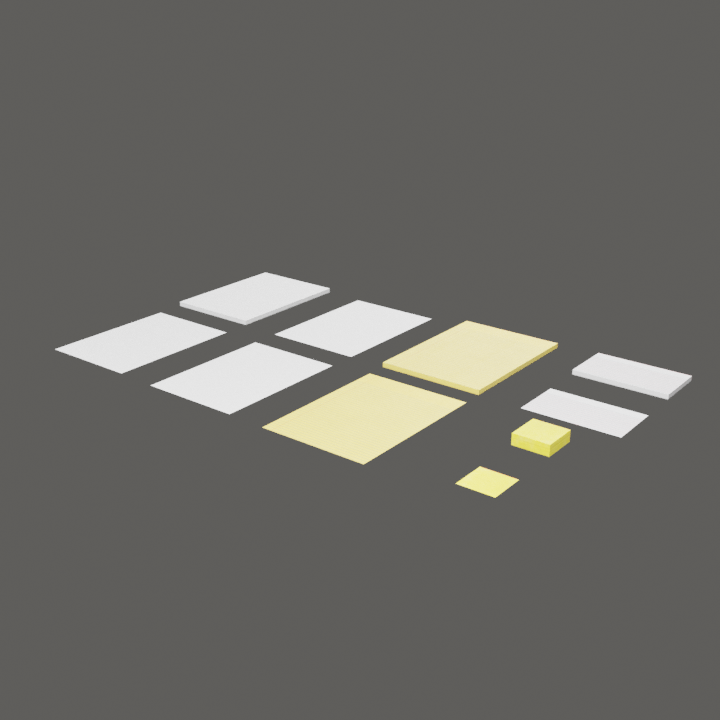 | 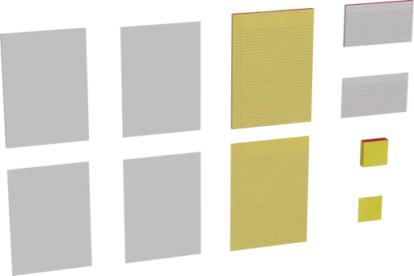 |
| 2 | [Stationery Supplies](https://polyhaven.com/a/stationery_supplies) | miscellaneous small items | 4412 | Mateusz Sadek | 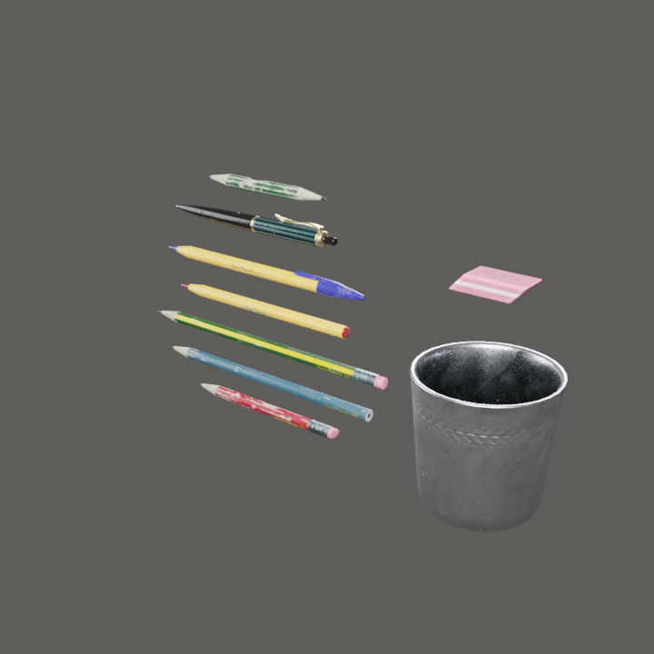 | 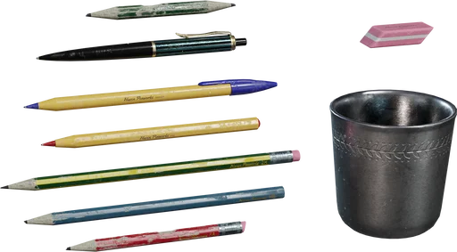 |
| 3 | [Clipboard](https://polyhaven.com/a/clipboard) | loose papers | 6176 | ProgrammerOnCoffee | 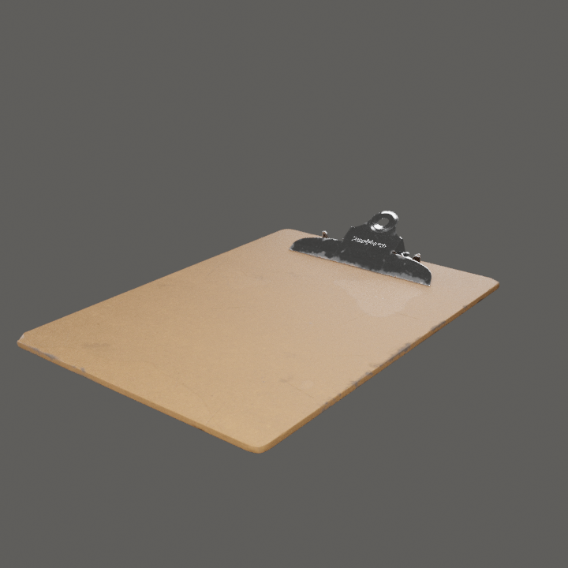 | 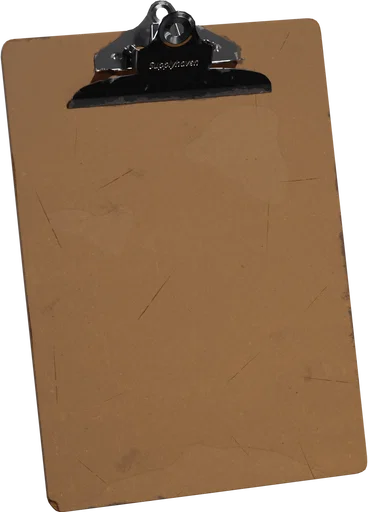 |
| 4 | [Plastic Thermos](https://polyhaven.com/a/plastic_thermos) | water bottle or cup | 5514 | PierreB3D | 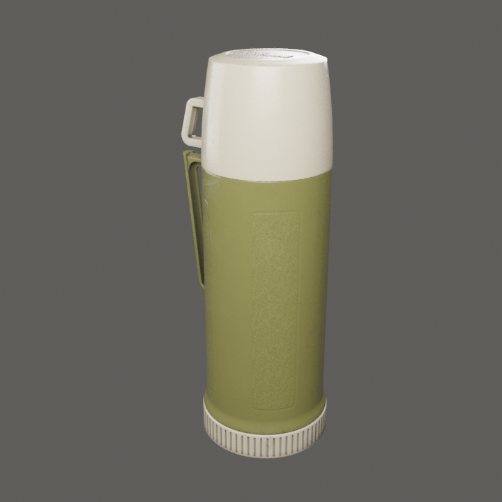 | 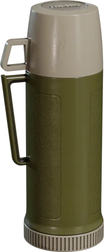 |
| 5 | [Plastic Crate 02](https://polyhaven.com/a/plastic_crate_02) | small storage box | 5840 | Fabi_G | 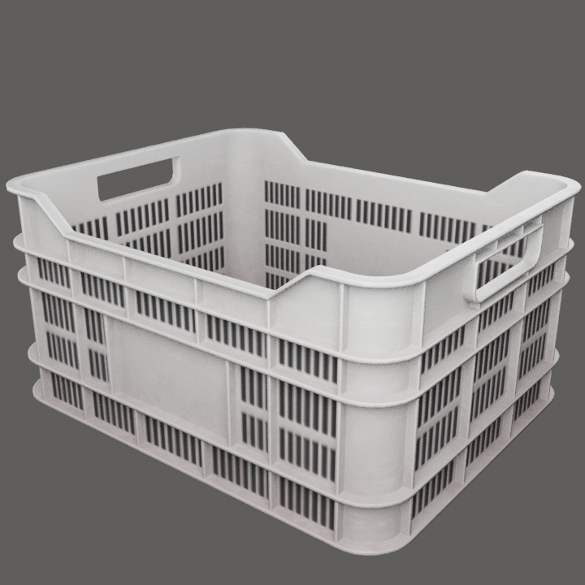 | 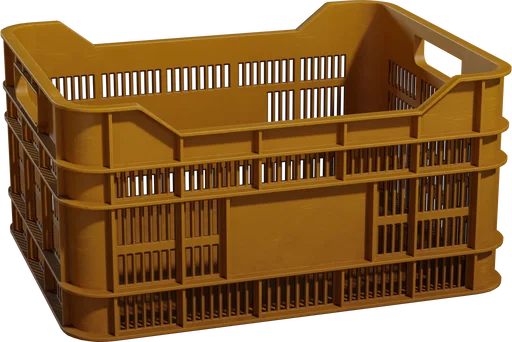 |
| 6 | [Industrial Plastic Container](https://polyhaven.com/a/industrial_pastic_container) | small storage box | 7118 | Galo Benivegna | 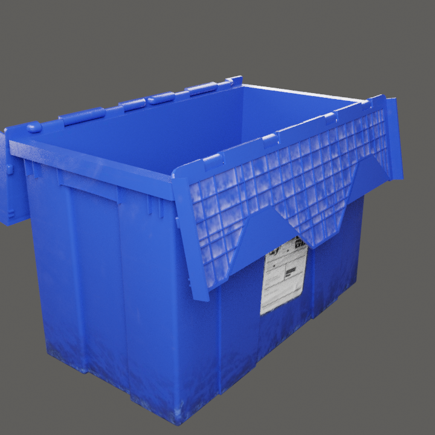 | 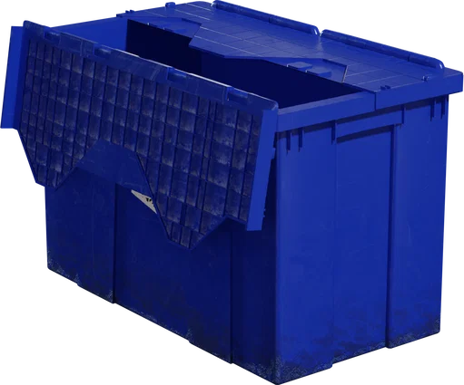 |
| 7 | [Gamepad](https://polyhaven.com/a/gamepad) | cables / chargers (electronics) | 9546 | Josh Dean | 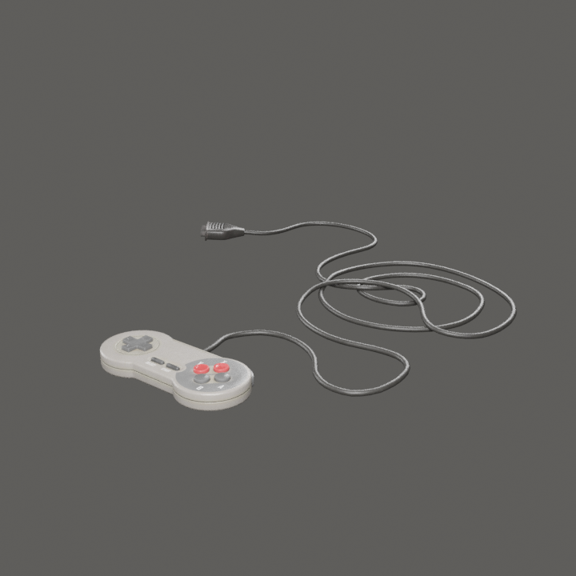 | 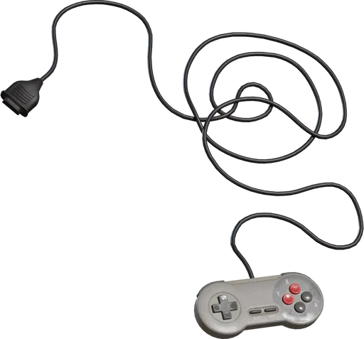 |
| 8 | [Retro Multimeter](https://polyhaven.com/a/retro_multimeter) | cables / chargers (electronics) | 13356 | elli moeller | 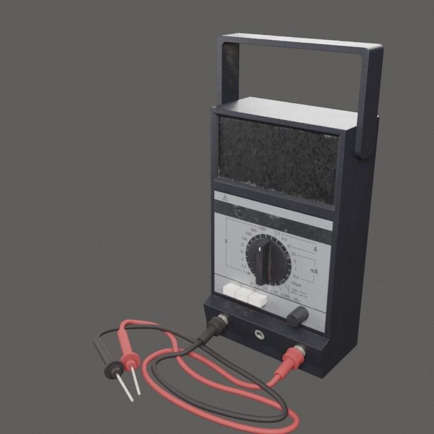 | 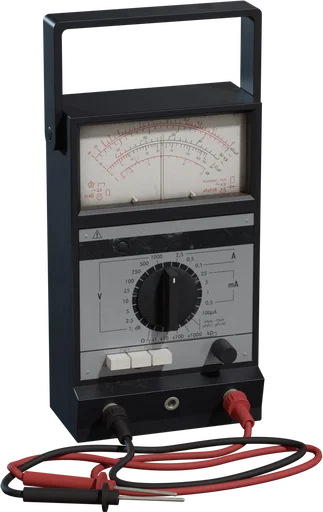 |
| 9 | [Cassette Player](https://polyhaven.com/a/cassette_player) | miscellaneous small items | 4830 | Oday Abuzaeed | 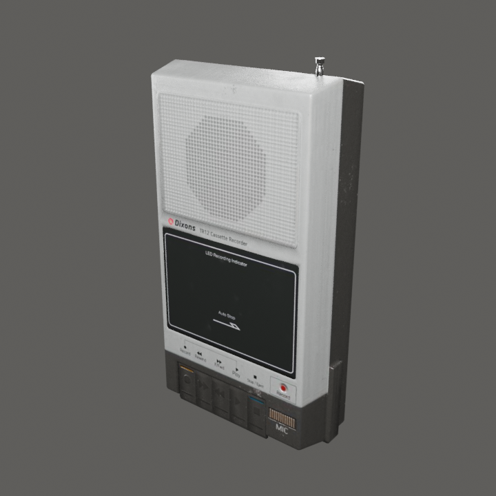 | 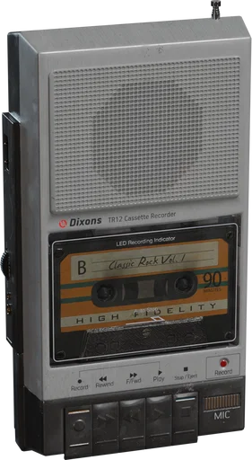 |
| 10 | [Wall Clock](https://polyhaven.com/a/wall_clock) | room dressing | 3658 | PierreB3D | 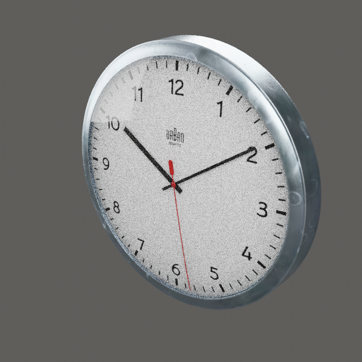 | 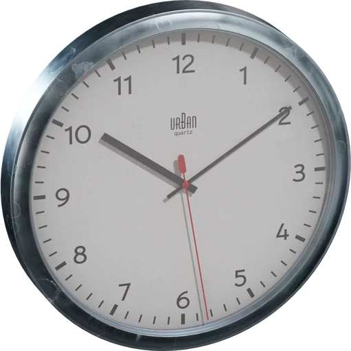 |
| 11 | [Alarm Clock 01](https://polyhaven.com/a/alarm_clock_01) | miscellaneous small items | 13006 | Yann Kervran, James Ray Cock | 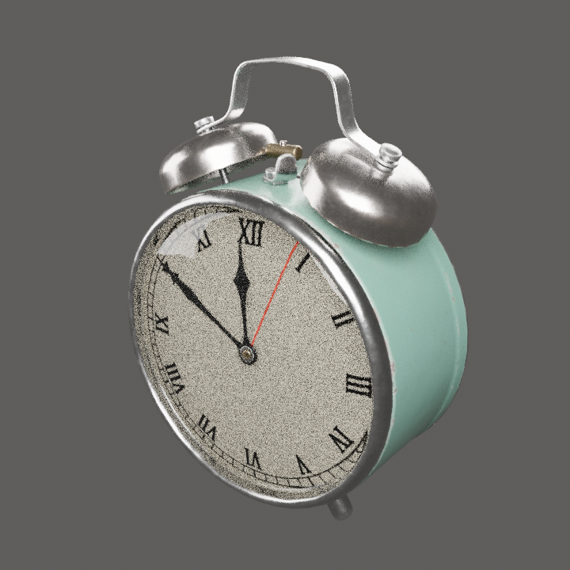 | 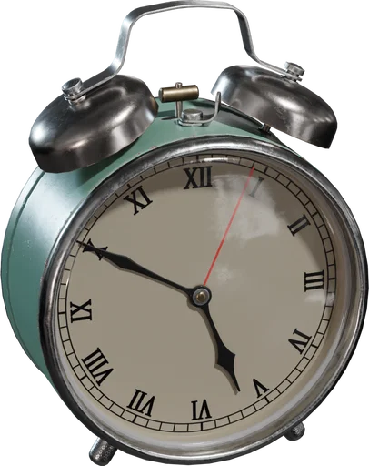 |
| 12 | [Wooden Broom](https://polyhaven.com/a/wooden_broom) | lived-in utility | 14258 | Balen | 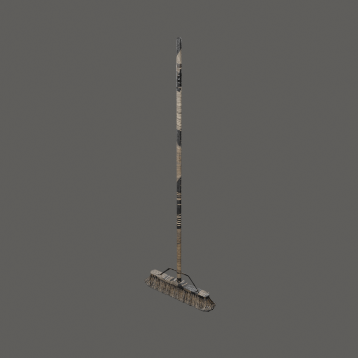 | 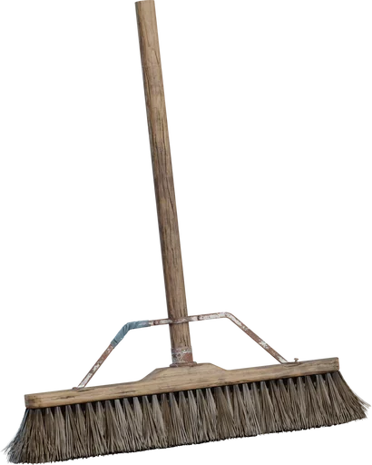 |
| 13 | [Vintage Flashlight](https://polyhaven.com/a/vintage_flashlight) | lived-in utility | 10562 | Omar M. El-Safy | 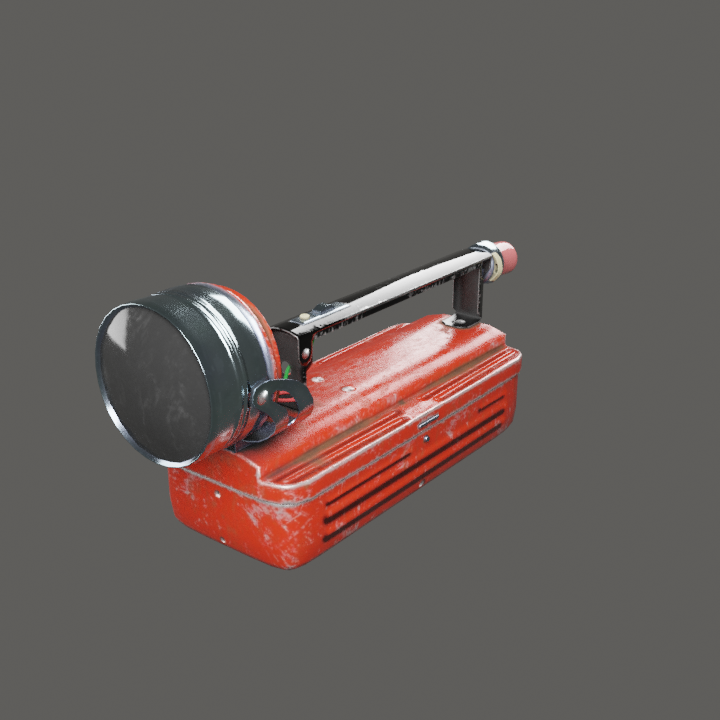 | 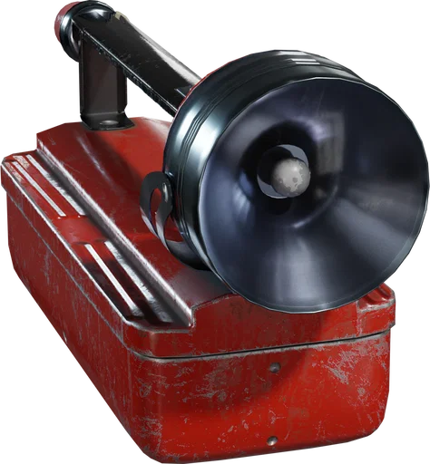 |

Preview columns: left is a local Cycles render of the exact downloaded FBX (1K JPG maps, glass simplified); right is the official source render.

## 1. Office Notepads

- **Source:** https://polyhaven.com/a/office_notepads
- **Author:** Ulan Cabanilla
- **License:** CC0-1.0 (https://polyhaven.com/license); attribution not required
- **Geometry:** 666 triangles; source bounds 1.103 x 0.660 x 0.022 m (measured FBX union 1.103 x 0.660 x 0.022 m)
- **Suggested use:** Loose notepads, blank sheets and sticky notes scattered on the desk or shelf edge; covers the approved "loose papers" lived-in category.
- **Suggested placement:** Desk corner or shelf edge, near the streaming workstation.
- **Import guidance:** texture preset 512 px, mipmaps on, anisotropy 2, simple fitted collider, no lights/cameras/animation, no automatic mesh colliders
- **Files:**
  - `assets/office_notepads/office_notepads_1k.fbx` - 52,268 bytes, sha256 `f59605849d17e497...`
    - source: https://dl.polyhaven.org/file/ph-assets/Models/fbx/1k/office_notepads/office_notepads_1k.fbx
  - `assets/office_notepads/textures/office_notepads_nor_gl_1k.jpg` - 393,394 bytes, sha256 `d6be173e3c16755e...`
    - source: https://dl.polyhaven.org/file/ph-assets/Models/jpg/1k/office_notepads/office_notepads_nor_gl_1k.jpg
  - `assets/office_notepads/textures/office_notepads_diff_1k.jpg` - 460,873 bytes, sha256 `6cce5f76748a7395...`
    - source: https://dl.polyhaven.org/file/ph-assets/Models/jpg/1k/office_notepads/office_notepads_diff_1k.jpg
  - `assets/office_notepads/textures/office_notepads_arm_1k.jpg` - 445,320 bytes, sha256 `a4a1c7356075ab0d...`
    - source: https://dl.polyhaven.org/file/ph-assets/Models/jpg/1k/office_notepads/office_notepads_arm_1k.jpg
  - `assets/office_notepads/source-preview.png` - 17,160 bytes, sha256 `8f378a6ee5ff78b4...`
    - source: https://cdn.polyhaven.com/asset_img/thumbs/office_notepads.png?width=512&height=512&format=webp&v=665f6900

## 2. Stationery Supplies

- **Source:** https://polyhaven.com/a/stationery_supplies
- **Author:** Mateusz Sadek
- **License:** CC0-1.0 (https://polyhaven.com/license); attribution not required
- **Geometry:** 4412 triangles; source bounds 0.302 x 0.084 x 0.164 m (measured FBX union 0.302 x 0.084 x 0.164 m)
- **Suggested use:** Pens, pencils and an eraser in a worn metal cup; small desk clutter for the student routine.
- **Suggested placement:** Workstation desk, beside the monitor or keyboard.
- **Import guidance:** texture preset 512 px, mipmaps on, anisotropy 2, simple fitted collider, no lights/cameras/animation, no automatic mesh colliders
- **Files:**
  - `assets/stationery_supplies/stationery_supplies_1k.fbx` - 187,756 bytes, sha256 `a1944f67fc094b94...`
    - source: https://dl.polyhaven.org/file/ph-assets/Models/fbx/1k/stationery_supplies/stationery_supplies_1k.fbx
  - `assets/stationery_supplies/textures/stationery_supplies_nor_gl_1k.jpg` - 475,821 bytes, sha256 `23c332f95ca9cafc...`
    - source: https://dl.polyhaven.org/file/ph-assets/Models/jpg/1k/stationery_supplies/stationery_supplies_nor_gl_1k.jpg
  - `assets/stationery_supplies/textures/stationery_supplies_diff_1k.jpg` - 646,389 bytes, sha256 `a70e92052b2da345...`
    - source: https://dl.polyhaven.org/file/ph-assets/Models/jpg/1k/stationery_supplies/stationery_supplies_diff_1k.jpg
  - `assets/stationery_supplies/textures/stationery_supplies_arm_1k.jpg` - 720,443 bytes, sha256 `b7b00e07f043d992...`
    - source: https://dl.polyhaven.org/file/ph-assets/Models/jpg/1k/stationery_supplies/stationery_supplies_arm_1k.jpg
  - `assets/stationery_supplies/source-preview.png` - 31,500 bytes, sha256 `070de7adcbf1630a...`
    - source: https://cdn.polyhaven.com/asset_img/thumbs/stationery_supplies.png?width=512&height=512&format=webp&v=a04c82ba

## 3. Clipboard

- **Source:** https://polyhaven.com/a/clipboard
- **Author:** ProgrammerOnCoffee
- **License:** CC0-1.0 (https://polyhaven.com/license); attribution not required
- **Geometry:** 6176 triangles; source bounds 0.229 x 0.337 x 0.042 m (measured FBX union 0.229 x 0.337 x 0.042 m)
- **Suggested use:** Worn clipboard holding a sheet; document clutter that reads as study/work material.
- **Suggested placement:** Desk or shelf, flat on a surface so it does not float.
- **Import guidance:** texture preset 512 px, mipmaps on, anisotropy 2, simple fitted collider, no lights/cameras/animation, no automatic mesh colliders
- **Files:**
  - `assets/clipboard/clipboard_1k.fbx` - 186,732 bytes, sha256 `48fe1c8fb9090916...`
    - source: https://dl.polyhaven.org/file/ph-assets/Models/fbx/1k/clipboard/clipboard_1k.fbx
  - `assets/clipboard/textures/clipboard_nor_gl_1k.jpg` - 406,898 bytes, sha256 `ea6700ba02622265...`
    - source: https://dl.polyhaven.org/file/ph-assets/Models/jpg/1k/clipboard/clipboard_nor_gl_1k.jpg
  - `assets/clipboard/textures/clipboard_diff_1k.jpg` - 572,026 bytes, sha256 `2e823a490f24a70f...`
    - source: https://dl.polyhaven.org/file/ph-assets/Models/jpg/1k/clipboard/clipboard_diff_1k.jpg
  - `assets/clipboard/textures/clipboard_arm_1k.jpg` - 620,747 bytes, sha256 `79658043713f9adb...`
    - source: https://dl.polyhaven.org/file/ph-assets/Models/jpg/1k/clipboard/clipboard_arm_1k.jpg
  - `assets/clipboard/source-preview.png` - 15,866 bytes, sha256 `f495d4fd5a162ea3...`
    - source: https://cdn.polyhaven.com/asset_img/thumbs/clipboard.png?width=512&height=512&format=webp&v=f6771d2a

## 4. Plastic Thermos

- **Source:** https://polyhaven.com/a/plastic_thermos
- **Author:** PierreB3D
- **License:** CC0-1.0 (https://polyhaven.com/license); attribution not required
- **Geometry:** 5514 triangles; source bounds 0.141 x 0.109 x 0.320 m (measured FBX union 0.141 x 0.109 x 0.320 m)
- **Suggested use:** Olive plastic thermos with cup lid; the standard water container for an Indonesian kos room.
- **Suggested placement:** Desk or bedside stool.
- **Import guidance:** texture preset 512 px, mipmaps on, anisotropy 2, simple fitted collider, no lights/cameras/animation, no automatic mesh colliders
- **Files:**
  - `assets/plastic_thermos/plastic_thermos_1k.fbx` - 163,324 bytes, sha256 `04beb90c26649ab9...`
    - source: https://dl.polyhaven.org/file/ph-assets/Models/fbx/1k/plastic_thermos/plastic_thermos_1k.fbx
  - `assets/plastic_thermos/textures/plastic_thermos_nor_gl_1k.jpg` - 364,839 bytes, sha256 `2d1e7525c7bc34fb...`
    - source: https://dl.polyhaven.org/file/ph-assets/Models/jpg/1k/plastic_thermos/plastic_thermos_nor_gl_1k.jpg
  - `assets/plastic_thermos/textures/plastic_thermos_diff_1k.jpg` - 289,855 bytes, sha256 `14cd6b03824ee4f4...`
    - source: https://dl.polyhaven.org/file/ph-assets/Models/jpg/1k/plastic_thermos/plastic_thermos_diff_1k.jpg
  - `assets/plastic_thermos/textures/plastic_thermos_arm_1k.jpg` - 678,833 bytes, sha256 `4438bf3575a49047...`
    - source: https://dl.polyhaven.org/file/ph-assets/Models/jpg/1k/plastic_thermos/plastic_thermos_arm_1k.jpg
  - `assets/plastic_thermos/source-preview.png` - 15,996 bytes, sha256 `8231e333d51fa271...`
    - source: https://cdn.polyhaven.com/asset_img/thumbs/plastic_thermos.png?width=512&height=512&format=webp&v=201afde1

## 5. Plastic Crate 02

- **Source:** https://polyhaven.com/a/plastic_crate_02
- **Author:** Fabi_G
- **License:** CC0-1.0 (https://polyhaven.com/license); attribution not required
- **Geometry:** 5840 triangles; source bounds 0.505 x 0.406 x 0.254 m (measured FBX union 0.505 x 0.406 x 0.254 m)
- **Suggested use:** Stackable plastic crate for personal storage (books, cables, supplies).
- **Suggested placement:** Under the bed or at the foot of the wardrobe, on the floor.
- **Import guidance:** texture preset 512 px, mipmaps on, anisotropy 2, simple fitted collider, no lights/cameras/animation, no automatic mesh colliders
- **Files:**
  - `assets/plastic_crate_02/plastic_crate_02_1k.fbx` - 135,532 bytes, sha256 `93f5fd277c554b91...`
    - source: https://dl.polyhaven.org/file/ph-assets/Models/fbx/1k/plastic_crate_02/plastic_crate_02_1k.fbx
  - `assets/plastic_crate_02/textures/plastic_crate_02_nor_gl_1k.jpg` - 558,561 bytes, sha256 `492b4cb03b043fb3...`
    - source: https://dl.polyhaven.org/file/ph-assets/Models/jpg/1k/plastic_crate_02/plastic_crate_02_nor_gl_1k.jpg
  - `assets/plastic_crate_02/textures/plastic_crate_02_diff_1k.jpg` - 492,862 bytes, sha256 `f153478d5f44f39a...`
    - source: https://dl.polyhaven.org/file/ph-assets/Models/jpg/1k/plastic_crate_02/plastic_crate_02_diff_1k.jpg
  - `assets/plastic_crate_02/textures/plastic_crate_02_arm_1k.jpg` - 597,561 bytes, sha256 `f0c667358c7afd46...`
    - source: https://dl.polyhaven.org/file/ph-assets/Models/jpg/1k/plastic_crate_02/plastic_crate_02_arm_1k.jpg
  - `assets/plastic_crate_02/source-preview.png` - 45,352 bytes, sha256 `4323c80df3356bd7...`
    - source: https://cdn.polyhaven.com/asset_img/thumbs/plastic_crate_02.png?width=512&height=512&format=webp&v=e6f7ff77

## 6. Industrial Plastic Container

- **Source:** https://polyhaven.com/a/industrial_pastic_container
- **Author:** Galo Benivegna
- **License:** CC0-1.0 (https://polyhaven.com/license); attribution not required
- **Geometry:** 7118 triangles; source bounds 0.476 x 0.631 x 0.423 m (measured FBX union 0.476 x 0.631 x 0.423 m)
- **Suggested use:** Lidded plastic storage box with ribbed sides; storage for clothing or electronics.
- **Suggested placement:** Top of the wardrobe or under the desk.
- **Import guidance:** texture preset 512 px, mipmaps on, anisotropy 2, simple fitted collider, no lights/cameras/animation, no automatic mesh colliders
- **Files:**
  - `assets/industrial_pastic_container/industrial_pastic_container_1k.fbx` - 203,484 bytes, sha256 `2ddbbcba61925927...`
    - source: https://dl.polyhaven.org/file/ph-assets/Models/fbx/1k/industrial_pastic_container/industrial_pastic_container_1k.fbx
  - `assets/industrial_pastic_container/textures/industrial_pastic_container_nor_gl_1k.jpg` - 125,304 bytes, sha256 `608ccf9fd66eed1c...`
    - source: https://dl.polyhaven.org/file/ph-assets/Models/jpg/1k/industrial_pastic_container/industrial_pastic_container_nor_gl_1k.jpg
  - `assets/industrial_pastic_container/textures/industrial_pastic_container_diff_1k.jpg` - 184,497 bytes, sha256 `dd4711467c6976f5...`
    - source: https://dl.polyhaven.org/file/ph-assets/Models/jpg/1k/industrial_pastic_container/industrial_pastic_container_diff_1k.jpg
  - `assets/industrial_pastic_container/textures/industrial_pastic_container_arm_1k.jpg` - 881,895 bytes, sha256 `41e9b8f374013fc5...`
    - source: https://dl.polyhaven.org/file/ph-assets/Models/jpg/1k/industrial_pastic_container/industrial_pastic_container_arm_1k.jpg
  - `assets/industrial_pastic_container/source-preview.png` - 24,886 bytes, sha256 `32d537490e7fd53a...`
    - source: https://cdn.polyhaven.com/asset_img/thumbs/industrial_pastic_container.png?width=512&height=512&format=webp&v=c1aa7f7b

## 7. Gamepad

- **Source:** https://polyhaven.com/a/gamepad
- **Author:** Josh Dean
- **License:** CC0-1.0 (https://polyhaven.com/license); attribution not required
- **Geometry:** 9546 triangles; source bounds 0.404 x 0.435 x 0.019 m (measured FBX union 0.404 x 0.435 x 0.019 m)
- **Suggested use:** Worn wired gamepad with its coiled cable; streamer/gamer clutter and a believable cable source.
- **Suggested placement:** Desk surface next to the keyboard.
- **Import guidance:** texture preset 512 px, mipmaps on, anisotropy 2, simple fitted collider, no lights/cameras/animation, no automatic mesh colliders
- **Files:**
  - `assets/gamepad/gamepad_1k.fbx` - 270,956 bytes, sha256 `a4f136b9b7c05a94...`
    - source: https://dl.polyhaven.org/file/ph-assets/Models/fbx/1k/gamepad/gamepad_1k.fbx
  - `assets/gamepad/textures/gamepad_diff_1k.jpg` - 309,469 bytes, sha256 `d66b82f9790c304e...`
    - source: https://dl.polyhaven.org/file/ph-assets/Models/jpg/1k/gamepad/gamepad_diff_1k.jpg
  - `assets/gamepad/textures/gamepad_nor_gl_1k.jpg` - 241,556 bytes, sha256 `90b7eb4ce8578797...`
    - source: https://dl.polyhaven.org/file/ph-assets/Models/jpg/1k/gamepad/gamepad_nor_gl_1k.jpg
  - `assets/gamepad/textures/gamepad_arm_1k.jpg` - 510,273 bytes, sha256 `cb5481bb081c12a9...`
    - source: https://dl.polyhaven.org/file/ph-assets/Models/jpg/1k/gamepad/gamepad_arm_1k.jpg
  - `assets/gamepad/source-preview.png` - 32,248 bytes, sha256 `536242bae0d09126...`
    - source: https://cdn.polyhaven.com/asset_img/thumbs/gamepad.png?width=512&height=512&format=webp&v=18f750ce

## 8. Retro Multimeter

- **Source:** https://polyhaven.com/a/retro_multimeter
- **Author:** elli moeller
- **License:** CC0-1.0 (https://polyhaven.com/license); attribution not required
- **Geometry:** 13356 triangles; source bounds 0.216 x 0.203 x 0.279 m (measured FBX union 0.216 x 0.203 x 0.279 m)
- **Suggested use:** Analog multimeter with coiled red/black probes; fits Raka tinkering with his stream rig.
- **Suggested placement:** Desk or shelf; keep the probes resting on the surface.
- **Import guidance:** texture preset 512 px, mipmaps on, anisotropy 2, simple fitted collider, no lights/cameras/animation, no automatic mesh colliders
- **Files:**
  - `assets/retro_multimeter/retro_multimeter_1k.fbx` - 339,596 bytes, sha256 `f3b459c105d11da9...`
    - source: https://dl.polyhaven.org/file/ph-assets/Models/fbx/1k/retro_multimeter/retro_multimeter_1k.fbx
  - `assets/retro_multimeter/textures/retro_multimeter_nor_gl_1k.jpg` - 252,642 bytes, sha256 `d30fd3007cb35e62...`
    - source: https://dl.polyhaven.org/file/ph-assets/Models/jpg/1k/retro_multimeter/retro_multimeter_nor_gl_1k.jpg
  - `assets/retro_multimeter/textures/retro_multimeter_diff_1k.jpg` - 399,388 bytes, sha256 `46baf6d9026f3cc7...`
    - source: https://dl.polyhaven.org/file/ph-assets/Models/jpg/1k/retro_multimeter/retro_multimeter_diff_1k.jpg
  - `assets/retro_multimeter/textures/retro_multimeter_arm_1k.jpg` - 454,111 bytes, sha256 `3fbf956cfc9830fb...`
    - source: https://dl.polyhaven.org/file/ph-assets/Models/jpg/1k/retro_multimeter/retro_multimeter_arm_1k.jpg
  - `assets/retro_multimeter/source-preview.png` - 26,394 bytes, sha256 `bce4dff12cb00295...`
    - source: https://cdn.polyhaven.com/asset_img/thumbs/retro_multimeter.png?width=512&height=512&format=webp&v=014e4b6a

## 9. Cassette Player

- **Source:** https://polyhaven.com/a/cassette_player
- **Author:** Oday Abuzaeed
- **License:** CC0-1.0 (https://polyhaven.com/license); attribution not required
- **Geometry:** 4830 triangles; source bounds 0.130 x 0.049 x 0.237 m (measured FBX union 0.130 x 0.049 x 0.237 m)
- **Suggested use:** Old radio/cassette unit; lived-in music device for a budget room.
- **Suggested placement:** Shelf or desk edge, against the wall.
- **Import guidance:** texture preset 512 px, mipmaps on, anisotropy 2, simple fitted collider, no lights/cameras/animation, no automatic mesh colliders
- **Files:**
  - `assets/cassette_player/cassette_player_1k.fbx` - 233,212 bytes, sha256 `9254cb8460568fbb...`
    - source: https://dl.polyhaven.org/file/ph-assets/Models/fbx/1k/cassette_player/cassette_player_1k.fbx
  - `assets/cassette_player/textures/cassette_player_tape_orangeblue_diff_1k.jpg` - 155,829 bytes, sha256 `17dc2f98a700e2e2...`
    - source: https://dl.polyhaven.org/file/ph-assets/Models/jpg/1k/cassette_player/cassette_player_tape_orangeblue_diff_1k.jpg
  - `assets/cassette_player/textures/cassette_player_body_nor_gl_1k.jpg` - 138,542 bytes, sha256 `1fad4388095f157a...`
    - source: https://dl.polyhaven.org/file/ph-assets/Models/jpg/1k/cassette_player/cassette_player_body_nor_gl_1k.jpg
  - `assets/cassette_player/textures/cassette_player_tape_arm_1k.jpg` - 102,646 bytes, sha256 `ac1c67cc2871ff3f...`
    - source: https://dl.polyhaven.org/file/ph-assets/Models/jpg/1k/cassette_player/cassette_player_tape_arm_1k.jpg
  - `assets/cassette_player/textures/cassette_player_body_arm_1k.jpg` - 180,349 bytes, sha256 `2bfc0ee4521354c8...`
    - source: https://dl.polyhaven.org/file/ph-assets/Models/jpg/1k/cassette_player/cassette_player_body_arm_1k.jpg
  - `assets/cassette_player/textures/cassette_player_body_diff_1k.jpg` - 92,420 bytes, sha256 `2ba804ff09613f4e...`
    - source: https://dl.polyhaven.org/file/ph-assets/Models/jpg/1k/cassette_player/cassette_player_body_diff_1k.jpg
  - `assets/cassette_player/textures/cassette_player_tape_nor_gl_1k.jpg` - 119,871 bytes, sha256 `99a5c90fdc8d3bfa...`
    - source: https://dl.polyhaven.org/file/ph-assets/Models/jpg/1k/cassette_player/cassette_player_tape_nor_gl_1k.jpg
  - `assets/cassette_player/source-preview.png` - 29,850 bytes, sha256 `2b5d3752562aa824...`
    - source: https://cdn.polyhaven.com/asset_img/thumbs/cassette_player.png?width=512&height=512&format=webp&v=3124c347

## 10. Wall Clock

- **Source:** https://polyhaven.com/a/wall_clock
- **Author:** PierreB3D
- **License:** CC0-1.0 (https://polyhaven.com/license); attribution not required
- **Geometry:** 3658 triangles; source bounds 0.321 x 0.047 x 0.321 m (measured FBX union 0.321 x 0.047 x 0.321 m)
- **Suggested use:** Wall clock with worn bezel; typical kos room fixture and a quiet horror-friendly prop.
- **Suggested placement:** Wall, above the desk or near the door.
- **Import guidance:** texture preset 512 px, mipmaps on, anisotropy 2, simple fitted collider, no lights/cameras/animation, no automatic mesh colliders
- **Files:**
  - `assets/wall_clock/wall_clock_1k.fbx` - 153,756 bytes, sha256 `1134703dab540da8...`
    - source: https://dl.polyhaven.org/file/ph-assets/Models/fbx/1k/wall_clock/wall_clock_1k.fbx
  - `assets/wall_clock/textures/wall_clock_nor_gl_1k.jpg` - 236,489 bytes, sha256 `6138946e055828e9...`
    - source: https://dl.polyhaven.org/file/ph-assets/Models/jpg/1k/wall_clock/wall_clock_nor_gl_1k.jpg
  - `assets/wall_clock/textures/wall_clock_diff_1k.jpg` - 366,683 bytes, sha256 `012bfc3ceecd5e35...`
    - source: https://dl.polyhaven.org/file/ph-assets/Models/jpg/1k/wall_clock/wall_clock_diff_1k.jpg
  - `assets/wall_clock/textures/wall_clock_arm_1k.jpg` - 444,044 bytes, sha256 `c78aabec7bb4af4f...`
    - source: https://dl.polyhaven.org/file/ph-assets/Models/jpg/1k/wall_clock/wall_clock_arm_1k.jpg
  - `assets/wall_clock/textures/wall_clock_glass_arm_1k.jpg` - 376,244 bytes, sha256 `42804955958b3d0f...`
    - source: https://dl.polyhaven.org/file/ph-assets/Models/jpg/1k/wall_clock/wall_clock_glass_arm_1k.jpg
  - `assets/wall_clock/source-preview.png` - 27,046 bytes, sha256 `05e961d2a529f2ab...`
    - source: https://cdn.polyhaven.com/asset_img/thumbs/wall_clock.png?width=512&height=512&format=webp&v=65459aa0

## 11. Alarm Clock 01

- **Source:** https://polyhaven.com/a/alarm_clock_01
- **Author:** Yann Kervran, James Ray Cock
- **License:** CC0-1.0 (https://polyhaven.com/license); attribution not required
- **Geometry:** 13006 triangles; source bounds 0.228 x 0.168 x 0.174 m (measured FBX union 0.132 x 0.067 x 0.174 m)
- **Suggested use:** Twin-bell bedside alarm clock; supports the 03:45 story time without new gameplay.
- **Suggested placement:** Bedside stool or shelf. The model is rigged but no animation is used.
- **Import guidance:** texture preset 512 px, mipmaps on, anisotropy 2, simple fitted collider, no lights/cameras/animation, no automatic mesh colliders
- **Files:**
  - `assets/alarm_clock_01/alarm_clock_01_1k.fbx` - 491,004 bytes, sha256 `efc7881828eff2e4...`
    - source: https://dl.polyhaven.org/file/ph-assets/Models/fbx/1k/alarm_clock_01/alarm_clock_01_1k.fbx
  - `assets/alarm_clock_01/textures/alarm_clock_01_diff_1k.jpg` - 404,998 bytes, sha256 `deb82094c2c1aa8c...`
    - source: https://dl.polyhaven.org/file/ph-assets/Models/jpg/1k/alarm_clock_01/alarm_clock_01_diff_1k.jpg
  - `assets/alarm_clock_01/textures/alarm_clock_01_nor_gl_1k.jpg` - 420,026 bytes, sha256 `a0a7b35de5712e23...`
    - source: https://dl.polyhaven.org/file/ph-assets/Models/jpg/1k/alarm_clock_01/alarm_clock_01_nor_gl_1k.jpg
  - `assets/alarm_clock_01/textures/alarm_clock_01_arm_1k.jpg` - 538,163 bytes, sha256 `99727eb8908dfea5...`
    - source: https://dl.polyhaven.org/file/ph-assets/Models/jpg/1k/alarm_clock_01/alarm_clock_01_arm_1k.jpg
  - `assets/alarm_clock_01/source-preview.png` - 35,844 bytes, sha256 `d9572218f7d1f022...`
    - source: https://cdn.polyhaven.com/asset_img/thumbs/alarm_clock_01.png?width=512&height=512&format=webp&v=597e9c0a

## 12. Wooden Broom

- **Source:** https://polyhaven.com/a/wooden_broom
- **Author:** Balen
- **License:** CC0-1.0 (https://polyhaven.com/license); attribution not required
- **Geometry:** 14258 triangles; source bounds 0.490 x 0.113 x 1.454 m (measured FBX union 0.490 x 0.113 x 1.454 m)
- **Suggested use:** Weathered straw broom (sapu ijuk); the believable cleaning tool in a modest Indonesian room.
- **Suggested placement:** Leaning in a corner by the door or window, with a simple fitted collider.
- **Import guidance:** texture preset 512 px, mipmaps on, anisotropy 2, simple fitted collider, no lights/cameras/animation, no automatic mesh colliders
- **Files:**
  - `assets/wooden_broom/wooden_broom_1k.fbx` - 482,124 bytes, sha256 `7f06133cc5ec9aeb...`
    - source: https://dl.polyhaven.org/file/ph-assets/Models/fbx/1k/wooden_broom/wooden_broom_1k.fbx
  - `assets/wooden_broom/textures/wooden_broom_bristles_diff_1k.jpg` - 388,640 bytes, sha256 `deebfae62affe000...`
    - source: https://dl.polyhaven.org/file/ph-assets/Models/jpg/1k/wooden_broom/wooden_broom_bristles_diff_1k.jpg
  - `assets/wooden_broom/textures/wooden_broom_nor_gl_1k.jpg` - 873,442 bytes, sha256 `6ecda3297647a6b8...`
    - source: https://dl.polyhaven.org/file/ph-assets/Models/jpg/1k/wooden_broom/wooden_broom_nor_gl_1k.jpg
  - `assets/wooden_broom/textures/wooden_broom_diff_1k.jpg` - 759,771 bytes, sha256 `525f5ba0cb4669b4...`
    - source: https://dl.polyhaven.org/file/ph-assets/Models/jpg/1k/wooden_broom/wooden_broom_diff_1k.jpg
  - `assets/wooden_broom/textures/wooden_broom_arm_1k.jpg` - 885,939 bytes, sha256 `43692c6109afa9a3...`
    - source: https://dl.polyhaven.org/file/ph-assets/Models/jpg/1k/wooden_broom/wooden_broom_arm_1k.jpg
  - `assets/wooden_broom/source-preview.png` - 25,212 bytes, sha256 `b1d051e001176c16...`
    - source: https://cdn.polyhaven.com/asset_img/thumbs/wooden_broom.png?width=512&height=512&format=webp&v=47c9f648

## 13. Vintage Flashlight

- **Source:** https://polyhaven.com/a/vintage_flashlight
- **Author:** Omar M. El-Safy
- **License:** CC0-1.0 (https://polyhaven.com/license); attribution not required
- **Geometry:** 10562 triangles; source bounds 0.096 x 0.305 x 0.144 m (measured FBX union 0.096 x 0.305 x 0.144 m)
- **Suggested use:** Worn flashlight for power cuts; atmospheric prop that fits the horror opening without adding mechanics.
- **Suggested placement:** Bedside shelf or under the bed edge.
- **Import guidance:** texture preset 512 px, mipmaps on, anisotropy 2, simple fitted collider, no lights/cameras/animation, no automatic mesh colliders
- **Files:**
  - `assets/vintage_flashlight/vintage_flashlight_1k.fbx` - 314,380 bytes, sha256 `9e459e4c836cd553...`
    - source: https://dl.polyhaven.org/file/ph-assets/Models/fbx/1k/vintage_flashlight/vintage_flashlight_1k.fbx
  - `assets/vintage_flashlight/textures/vintage_flashlight_nor_gl_1k.jpg` - 164,093 bytes, sha256 `a4474869f8e0d721...`
    - source: https://dl.polyhaven.org/file/ph-assets/Models/jpg/1k/vintage_flashlight/vintage_flashlight_nor_gl_1k.jpg
  - `assets/vintage_flashlight/textures/vintage_flashlight_diff_1k.jpg` - 550,114 bytes, sha256 `2b428ccd2c41ef56...`
    - source: https://dl.polyhaven.org/file/ph-assets/Models/jpg/1k/vintage_flashlight/vintage_flashlight_diff_1k.jpg
  - `assets/vintage_flashlight/textures/vintage_flashlight_arm_1k.jpg` - 620,007 bytes, sha256 `5183d389859b02f5...`
    - source: https://dl.polyhaven.org/file/ph-assets/Models/jpg/1k/vintage_flashlight/vintage_flashlight_arm_1k.jpg
  - `assets/vintage_flashlight/source-preview.png` - 39,510 bytes, sha256 `99f26737edc4628a...`
    - source: https://cdn.polyhaven.com/asset_img/thumbs/vintage_flashlight.png?width=512&height=512&format=webp&v=4e9a8dd7

## Considered but rejected

| Candidate | Reason |
| --- | --- |
| jug_01 | Glossy porcelain with pink tulips; too ornate and luxurious for a modest kos. |
| tea_set_01 | Victorian tea set; western and luxurious, and 40k triangles. |
| ceramic_vase_01 | Modern glossy decorative vase; no routine purpose in the room. |
| brass_goblets | Ornate brass goblets; western antique styling. |
| throw_pillows_01 | African zigzag print; visually inconsistent with the room. |
| postcard_set_01 | Western travel postcards; visually inconsistent. |
| vintage_suitcase | Travel stickers read as random decor without a routine purpose. |
| metal_jug | Farmhouse milk jug; not a believable Indonesian room prop. |
| vintage_electric_kettle | Specialty gooseneck design fights the modest kos styling. |
| electric_stove | Western mini oven; heavier (13.9k tris) and no approved placement. |
| boombox | Redundant with cassette_player at almost double the triangles. |
| plastic_broom | Plastic push broom; the wooden straw broom is the credible local choice. |
| modified_thermos | Redundant variant of plastic_thermos. |
| modular_electric_cables | 42k-tri industrial outdoor cables; too heavy and stylistically wrong for an interior. |
| ceramic_pot | Rustic western crock; no routine need identified yet. |
| dustpan | Could pair with the broom, but not part of the approved clutter list. |
| potted_plant_04 | Plausible but purely decorative; deferred to avoid random props. |
| classic_laptop | Redundant with the existing desktop workstation; deferred. |

## Gaps not covered by downloads

- **Used socks, flip-flops and worn clothing** - Poly Haven has no believable CC0 clothing items. The project already authors KosDroppedSocks, KosSandals, KosFoldedTshirt and HangingJacket, so downloads were not forced.
- **Realistic USB charger, power strip and loose cables** - Only modular_electric_cables exists and it is industrial (42k tris). The room already contains fitted charger/lead geometry; the gamepad and multimeter cover cable clutter.
- **Indonesian printed newspapers and documents** - No CC0 realistic source found; the project-authored newspaper and paper props remain in use.
- **Indonesia-specific appliances (rice cooker, gas hob, bamboo mat)** - Not available under CC0. Research deliberately stopped at sources with verified licenses instead of guessing at Sketchfab/OpenGameArt licenses.
