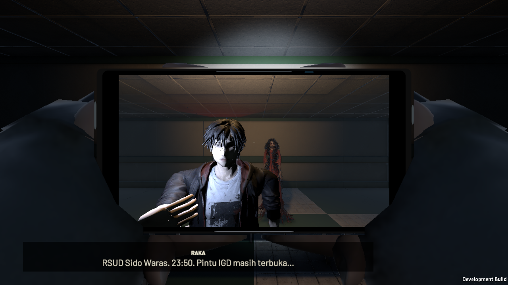
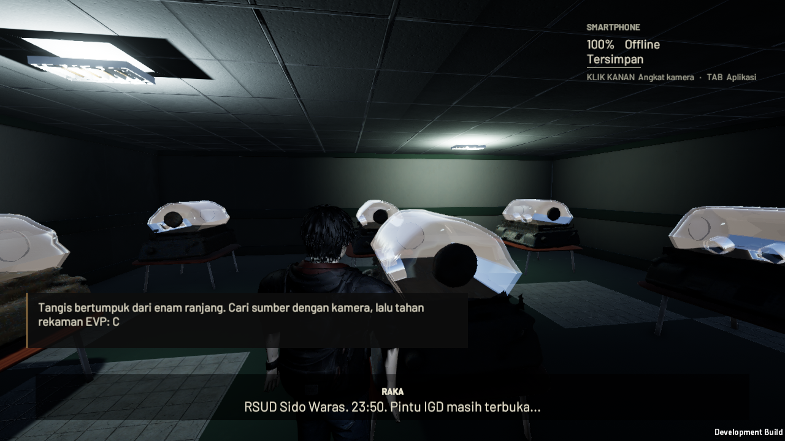

# Phase 2 Sesi 1 — implementasi dan validasi

Lingkup yang diizinkan: Adegan 1–4 sampai pintu Ruang Operasi. Sesi 2 belum diterapkan. Laporan ini membedakan implementasi, tes terarah dan penerimaan desainer; seluruh 100 QA spesifikasi belum dinyatakan lulus.

## Perubahan yang diterapkan

- Hub memakai Kos existing yang diperbesar desainer, dengan persiapan PC/forum, modul gratis, paket opsional memakai saldo sah, colokan satu kali dan keberangkatan eksplisit. Akhir P1 terhubung ke hub; Continue memilih scene dari campaign yang sama.
- Scene `Babak2_RSUD` berisi IGD, empat poli, dua jalur tangga fisik, kamar mayat, Arsip, Pos Petugas, koridor L2, enam stasiun neonatal dan Ruang Jaga Suster. Jalur investigasi berakhir pada pintu Ruang Operasi; tidak memberi boss-win, CP5–CP7 atau segel kedua.
- Selfie memakai kamera/render feed HP existing dan menampilkan tubuh Raka serta Lastri, sementara rear/main tidak menampilkan Lastri. Thermo adalah overlay target/lensa/LOS/dwell; AR aura dan foto, EVP enam detik, keypad 1603/2604, ketiga pusaka dan konfirmasi Jurnal terpisah.
- Lastri memakai **Merah.vrm desainer**, NavMesh, telegraph, jendela belajar, hold dengan perpindahan kapsul nyata, meter sentuhan, aturan menoleh, kolong/lemari dan detach pada zona tenang. Dokumen/menu menghentikan brain dan gerak agent; aplikasi biasa tidak mematikan risiko.
- Save tetap `CampaignState` yang sama, schema 3 dengan migrasi 1→2→3. Receipt, evidence, item, secret, belanja dan donasi terikat memakai transaksi atomik. Tidak ada save/event/inventori/AR paralel. Sanity dan saldo sah tidak diberi grant. CP4 tidak ditimpa checkpoint investigasi lebih awal.
- Baterai terbawa apa adanya. Dinamo memakai hold E, pengisian normal sekali per lokasi, emergency crank akumulatif dan cooldown. Bukaan Inkubator menjadi permanen sesudah crossing dan dapat dilalui kembali pada 0%.
- Pagar unduhan membatasi tepi halaman dan landing tangga; recovery jatuh mengembalikan pemain ke anchor tersimpan tanpa memberi baterai atau menghapus progres.
- Lingkungan menggunakan **44 model berbeda dari unduhan baru** (bukan aset lingkungan Prolog/P1), PBR, pencahayaan per ruang, batas lampu lintas lantai, reflection probe dan mist CC0 lokal. Sumber/hashes/lisensi ada pada `phase2-asset-sources.json` dan `phase2-asset-credits.md`.

## Verifikasi

- Syntax Python import/fetch/packing/package: lulus `py_compile`.
- Unity EditMode: **90/90 lulus** (Phase2CampaignTests, Phase2SceneTests, Phase1CampaignTests, PlayerFeelTests). Mencakup schema/carry-over/rollback, route NavMesh lintas lantai, independensi bukti/pusaka, reference scene, LOS C3, pemadaman layar saat transaksi mencapai 0%, LOS AR terhadap tembok terpilih, bukaan brankas fisik, ukuran/klip Lastri, transparansi dan LOS Inkubator, serta regresi genggaman/jongkok/presentasi pemain. Hasil XML dicatat bersama laporan final.
- Native standalone jalur investigasi: **55/55 pemeriksaan lulus**, kapsul menempuh sekitar **320 meter** melewati seluruh area Sesi 1, keypad nyata, sensor/framing/LOS, pickup, rahasia D1, urutan Suster sebelum Inkubator, konfirmasi Jurnal, pintu Operasi dan **reload scene sesungguhnya**. Posisi kembali ke anchor Suster; baterai 0%, bukaan permanen, bukti, pusaka dan rahasia tetap tersimpan. Bukti: `phase2-session1-player-route.json` dan `phase2-route-invocation.json`.
- Native recovery/input: **30/30 pemeriksaan lulus** untuk RMB offline, X, F, Tab, pause, dinamo +25/8 detik, crank 45 detik yang dapat dilanjutkan, cap 10%, cooldown, detach dengan persembunyian pada 0%, keluar/restore kapsul, pagar yang menahan kapsul nyata dan recovery jatuh ke anchor tanpa pemberian baterai. Bukti: `phase2-session1-player-recovery.json`.
- Kedua directed smoke memakai Linux standalone, **Null renderer dan simulasi 2×** dalam slot terisolasi; bukan bukti visual, kenyamanan kontrol manusia, atau FPS Windows. Pemeriksaan menggerakkan kapsul melalui collision nyata, tidak men-teleport sepanjang jalur. Hanya fixture safety yang ditandai memakai penempatan awal di kamar mayat.
- Review visual terpisah memakai **Linux OpenGL/llvmpipe 1280×720 pada 1×**. Gambar kamar mayat, inkubator kaca dan Selfie sudah dilihat; Merah tampak di belakang Raka melalui lensa depan. Kamera/penempatan pada review gambar adalah fixture tersusun, bukan bukti pacing AI. Bukti: `phase2-session1-visual-model.json`, `phase2-session1-visual-environment.json`, dan tiga `*-preview.png`.
- Percobaan awal disimpan pada `phase2-runtime-attempts.json`. Defek nyata yang diperbaiki: sumbu tangga, referensi hub, occlusion C3, flag layar pada 0%, brankas model-prefab/orientasi, pemicu keypad menutup botol, material kaca dan penempatan medis, serta binding/komposisi Selfie Lastri. Masalah penguji dipisahkan: koordinat kunci terlalu jauh, U-turn yang memang memicu POUNCE, jalur memotong daun brankas terbuka, pemeriksaan reload terlalu dini, dan timeout software renderer. Percobaan gagal tidak dihitung lulus.
- Build Windows x86_64 Development (Mono): berhasil, 0 error dan 6 warning pada BuildReport. Seluruh lima scene termasuk `Babak2_RSUD` masuk build. Snapshot 4.569 file sumber diverifikasi sesudah build. ZIP berukuran 521.430.132 byte, CRC dan seluruh 325 file build telah diverifikasi. Bukti: `phase2-windows-build-summary.json`, `phase2-windows-invocation.json` dan `phase2-session1-build-sources.json`. Upload R2 diverifikasi terpisah; tidak ada klaim playtest manual Windows.
- Delivery **24 Oktober 2026, 02:12 UTC**: ZIP baru berhasil diunggah ke `r2:layarterakhir/Layarterakhir/LayarTerakhir-Windows-x86_64-Development.zip`. Seluruh objek dibaca kembali; SHA-256 cocok dengan ZIP lokal: `df5855eed33fe222526156cf3c3b5808673adde6f678dcba488ca079ee2a7b8d`. Receipt: [r2-windows-build-upload.json](r2-windows-build-upload.json). Jalankan `Review-Phase2.cmd` kemudian **Continue** untuk slot review terpisah.

## Keterbatasan dan pekerjaan tersisa

- Boss, arena ritual, ilusi boss, CP5–CP7, epilog dan segel kedua adalah Sesi 2.
- Rekaman pemeran manusia Indonesia belum tersedia; Raka/Damar/kalimat EVP memakai subtitle kanon dan cue nonverbal berlisensi. Tidak menambah VO AI.
- Inkubator kaca diimpor dengan pemisahan material existing agar hood transparan tidak menutupi bukti/interaksi; alas memakai meja rumah sakit unduhan. Freezer adalah modul penyimpanan logam unduhan yang diadaptasi; gelang/rantai/perekam masih perlu penerimaan visual. Fade/patrol Lastri dan semua variasi occlusion perlu playtest manusia lebih luas.
- Tidak ada klaim kualitas sudah setara DreadOut/Outlast atau 60 FPS. Render software Linux dan directed smoke tidak membuktikan performa Windows, pacing, kenyamanan gerak, mutu audio subjektif, maupun seluruh 100 QA.
- Lisensi Madduck melarang distribusi aset lepas: binary Madduck tidak masuk repo publik. GUID sidecar dan pipeline unduhan/konversi tersedia untuk reproduksi; build menyertakan aset dalam game. Detail pada credits.

Panduan pengguna: [phase2-session1-review.md](phase2-session1-review.md). Arsitektur: [ARCHITECTURE.MD](../ARCHITECTURE.MD). Spesifikasi: [Phase2.MD](../Phase2.MD).

