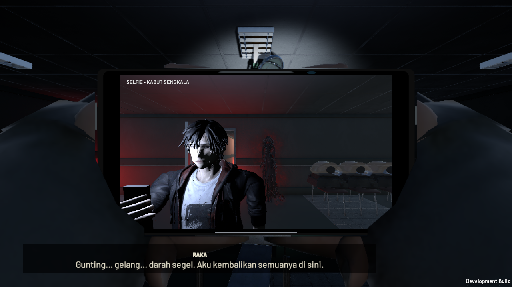
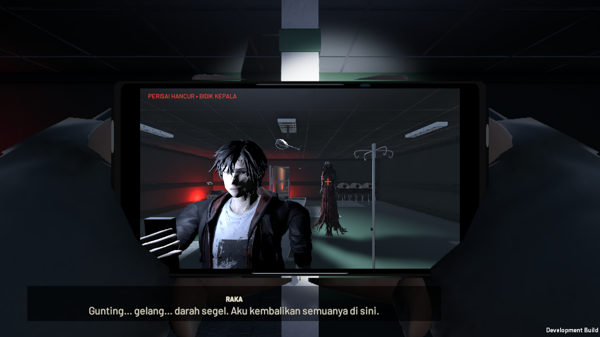
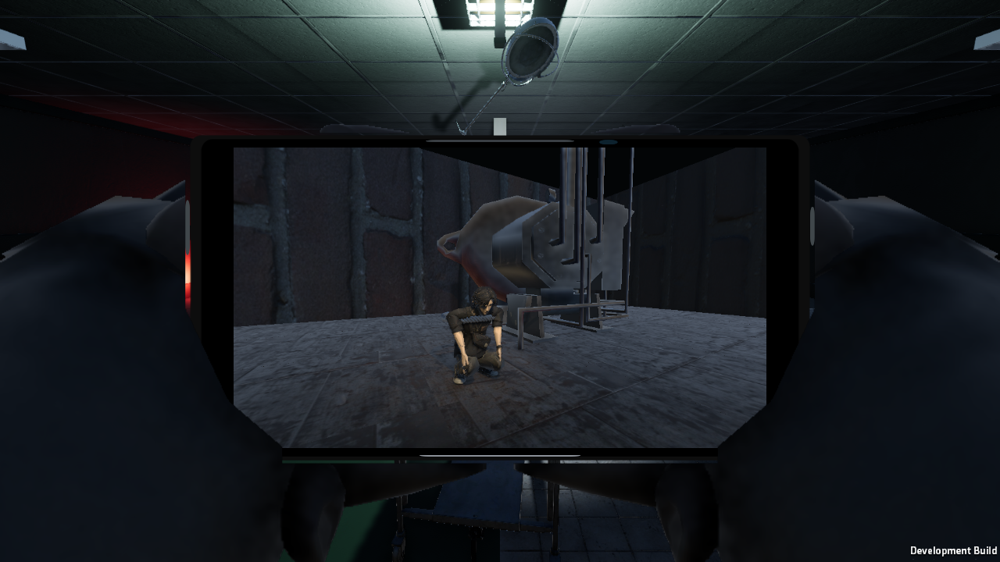

# Phase 2 Sesi 2 — implementasi, validasi dan delivery

Lingkup: Adegan 5–6 serta polish/QA yang melengkapi Sesi 1. Jalur diimplementasikan dari Kos sampai konfirmasi motor dan CP7. Babak 3 playable tidak dibuat; tujuannya disimpan untuk kelanjutan kampanye. Ini laporan build kandidat untuk review, bukan klaim seluruh100 QA/manual Windows atau mutu setara DreadOut/Outlast sudah diterima.

## Perubahan yang diterapkan

- Arena 12×12 m memakai aset rumah sakit berlisensi yang diunduh untuk Phase 2: meja, lampu operasi, UV-N/UV-S, dua generator, empat inkubator tua, loop dua arah, pintu dan batas collision.
- Brain investigasi menyerahkan kepemilikan aktor/agent Merah ke `Phase2Boss` selama ritual. PREP minimum30s, TRACK, EXPOSED5s, RECOVERY/POWER_RECOVERY minimum20s; kelanjutan hanya melalui E sadar di meja.
- Tiga siklus: pantau Selfie, pancing ke cahaya, bidik kepala dan Blitz. Selfie ritual dan rear sesudah membalik badan memakai feed dan biaya global15%/cooldown6s. Satu window tidak dapat memberi dua lapisan.
- Lampu hanya habis setelah sukses, miss/timeout mempertahankan sumber. Dua ilusi pada siklus2/3 dipilih melalui reticle Thermo (asli−20°C, palsu−6°C), pecah nonfatal, serta dibersihkan selama exposure. Pecahan kaca memakai pool empat emitter; flare memakai gambar CC0 Kenney dan ledger RAM.
- Generator manual +25/8s repeatable selama recovery dan sesudah boss. Baterai kurang15 pada TRACK memasuki recovery; nol tidak memberi WATCH_ONLY, top-up otomatis, atau Blitz gratis.
- CP5 memakai `CampaignState.TryCommit` existing sebelum mengunci attempt; `BeginCheckpointAttempt` melindungi seluruh jalur tulis. CP6 adalah satu transaksi segel kedua, perpindahan pusaka dan konsumsi flare yang menang. I/O failure dapat dicoba ulang; kematian/quit tidak menyimpan hit parsial.
- Ending menampilkan310.500 penonton dan capaian naratif Rp164.800.000; donasi Penonton_Terakhir tetap dana terikat. Video Damar8s memakai satu feed HP existing dan set rekaman non-playable di scene RSUD. Rekaman dapat diputar ulang tanpa reward.
- Raka memakai crouch/pose ponsel existing ketika sinematik; kamera/app/filter dipulihkan sesudahnya. Lastri shielded hanya di Selfie; EXPOSED boleh terlihat main/rear. Cahaya visual diperluas agar mencapai bidang kepala pada radius gameplay; kamera Selfie memeriksa segmen clearance sampai lensa.
- Setelah epilog pemain kembali bebas, termasuk ke D1 pada baterai0. Panel motor dapat dibatalkan; CP7 sukses mendahului CKREK dan hitam. Reload CP7 membangun handoff; menutupnya kembali ke menu tanpa dunia hitam yang terkunci.

## Verifikasi dan bukti

Bukti final dikumpulkan dalam XML/JSON yang ditautkan pada [matriks QA](PHASE2_QA_100.md). Setiap runtime invocation merekam argumen, waktu dan exit code sebenarnya.

- Unity EditMode:118 tes pada transaksi P2, scene, regresi Phase 1 dan player feel; hasil final `phase2-session2-editmode.xml`.
- Dua jalur lengkap lulus masing-masing115 pemeriksaan, sekitar488m dan635m (termasuk kembali ke D1). Satu jalur mengambil arsip opsional, satu tidak; keduanya tanpa belanja dan tanpa live manual di IGD: `phase2-session2-full-route.json` dan `phase2-session2-no-secret-route.json`. Kapsul bergerak melalui collision/NavMesh nyata, keypad/E/input kamera memakai sistem produksi. P1-complete di awal adalah fixture development terisolasi.
- Recovery boss38/38: `phase2-session2-boss-recovery.json` untuk shielded miss, timeout, pause, power recovery, ilusi terpilih, cooldown dan flare/CP5.
- Edge investigasi56/56 dan safety30/30: `phase2-session2-investigation-edges.json`, `phase2-session2-safety.json`. Fixture posisi ditandai sebagai fixture, bukan bukti traversal penuh.
- Zero-victory dan fault CP7 fixture73/73: `phase2-session2-zero-victory.json`; uji0%CP6/generator/epilog, panel dibatalkan3×, kegagalan disk tanpa fade/posisi berubah, retry dan reload handoff.
- Unit fault injection menguji20 rollback CP5, snapshot baterai0/1/14/15/29/44/45/80/100, owner mismatch, CP6/CP7 I/O failure. Ini tidak disamakan dengan20 pertarungan manusia atau9 run boss lengkap.
- Native smoke memakai Linux Null renderer dengan simulasi2× selama gameplay (invocation `--fast`; nilai TimeScale di hasil bisa0 ketika berakhir di menu); bukan bukti visual/FPS Windows. Render terpisah memakai OpenGL llvmpipe1280×7201× dengan fixture kamera tersusun. Gambar harus benar-benar diperiksa; hasil render dan hasil logika terpisah.
- Percobaan yang gagal dipertahankan pada `phase2-session2-runtime-attempts.json`. Koreksi meliputi oracle pengisian tambahan, jalur memancing UV-S, reparent glass-prefab, namespace material, visibility HP sinematik, framing Selfie, serta spawn ilusi. Kegagalan tidak dihitung sebagai pass.

## Aset dan reproduksi

Lingkungan tetap pustaka Phase 2, tidak menyalin lingkungan Prolog/Rusunawa.49 model path baru tercatat pada `phase2-scene-content.json`, di luar karakter/motor antarbabak. Sumber tambahan: Furnace (newArteest, CC BY4), Rope (Marcel Porsiel, CC BY4), Poly Haven pull-chain socket(CC0), part lampu/kain AutopsyLab(CC BY4), api/asap Kenney(CC0), glass(Till Behrend/CC0), chain(bart/CC0), shutter(Mike Koenig/CC BY3). URL dan SHA tercatat pada `phase2-session2-asset-sources.json` dan [credits](phase2-asset-credits.md). Tidak ada model, gambar, tekstur atau klip gerak original baru; konversi/optimasi/material adaptation/retarget yang diizinkan saja.

Reproduksi: pipeline Sesi1 untuk pustaka RSUD, lalu `Tools/fetch_phase2_session2_assets.py`, Blender `Tools/import_phase2_session2_assets.py`, packing PBR existing dan menu builder Phase2. Binary Madduck tetap dikecualikan dari Git sesuai lisensi; hanya distribusi dalam game. `Tools/run_phase2_review.py` menjalankan fixture terisolasi, bukan slot produksi.

## Delivery dan batas penerimaan

Build Windows x86_64 Development Mono berhasil:0 error,9 warning. Snapshot4629 file sumber cocok sesudah build. ZIP526.223.001 byte diverifikasi CRC serta seluruh325 file player; SHA-256 `0a5f92cb895c1383e7c94ef0b1b6c1ffb2d6cf4868c563b7d8244f73f8fc8a1b`. Ringkasan dan invocation: `phase2-session2-windows-build-summary.json`, `phase2-session2-windows-invocation.json`. Upload R2 berhasil dan seluruh objek remote dibaca ulang; SHA-256 cocok dengan ZIP lokal pada 24 Oktober 2026, 06:26:55 UTC. Bukti: [receipt R2](r2-windows-build-upload.json). Tidak ada klaim runtime Windows sudah dimainkan. Panduan pengguna: [review build](phase2-session1-review.md), jalankan `Review-Phase2.cmd` lalu Continue.

Seluruh100 kasus dipertahankan pada matriks, dengan status/batas bukti per kasus. Yang belum terbukti tetap terbuka: acceptance manual Windows/GPU sasaran/1%low/60FPS, pacing82menit, seluruh variasi input/remap/occlusion, dan mutu artistik/acting. Rekaman pemeran manusia Indonesia belum tersedia; dialog kanon memakai subtitle dan cue nonverbal berlisensi. Tidak membuat VO AI pengganti. Ambang freeze penuh belum dinyatakan lulus.

## Gambar review yang benar-benar diperiksa

Fixture kamera tersusun; bukan bukti pacing AI atau benchmark Windows.

